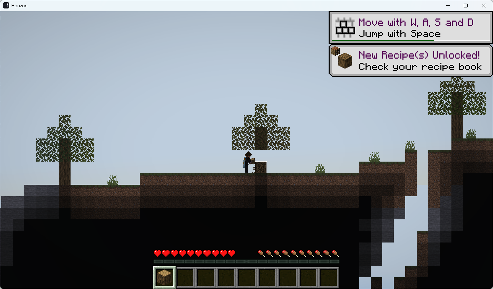

# Planar Worlds

Planar Worlds 是 Horizon 的 Rust 原生模组。它把《Minecraft》的主世界变成类似《泰拉瑞亚》的 2D 横版世界。你可以沿地表左右探索，也可以从侧面挖进洞穴、采矿和建造。

## 玩法

- **单层地形**。前景位于 `Z=0`，保留地表高差、洞穴、矿石、基岩和流体。新生成的区块会生成平面的树干和树冠。
- **固定侧视**。正交镜头沿 X/Y 平面跟随玩家，角色和生物以左右侧身显示。
- **剖面光照**。天空光和方块光沿剖面传播，岩层亮度逐格衰减，完全无光的矿石被黑暗遮住。
- **背景墙**。背景位于 `Z=1`，渲染在前景后方，可放置和挖掘，也可以直接穿过。

## 实机截图





## 操作

在 Horizon 的创建世界界面打开 **Planar Mode**，然后创建世界。

| 操作 | 效果 |
| --- | --- |
| `A` / `D`、空格 | 左右移动、跳跃 |
| 移动鼠标 | 瞄准触及范围内最先命中的方块，黑白线框标出目标 |
| 按住左键 | 持续挖掘命中的方块 |
| 右键 | 对命中的方块执行原版交互或放置 |
| 手持方块，按住右键指向空气 | 在触及范围内直接放置，最多 5 格，避开玩家身体占用的格子 |
| `Ctrl` + 左键 / 右键 | 挖掘 / 放置背景墙，灰色线框标出背景目标 |

树木生成修复会在新生成的区块生效。旧世界可以继续游玩和探索新区块。

## 功能限制与模组兼容性

- **维度与传送门**。当前的 Planar Mode 仅支持单人主世界。下界传送门、末地传送门，以及下界和末地的 2D 维度均未实现。
- **与其他模组的兼容性较低**。Planar Worlds 会修改世界生成、渲染、移动与碰撞以及方块交互。其他模组如果也修改这些系统，可能发生冲突。

## 安装

当前版本为 **0.3.6**，目标为 **Horizon / Minecraft 26.3**。原生构建固定到 Horizon 提交 `f82620a74aa1b5bb5f9a46785828ec90ee24e435`。当前玩法面向 Horizon 单人世界的主世界。

### 从源码构建

克隆本仓库并进入源码目录，在 Horizon 启动器选择要使用的实例并构建原生模组。也可以通过启动器的命令行显式指定源码目录和实例：

```sh
horizon-launcher native-build . --instance "实例名称" --trust-native-code
```

构建完成后，用该实例启动 Horizon。如果已有 `.hnmod` 安装包，也可以将其放入实例的 `horizon-native-mods/` 目录，启用 Planar Worlds，然后在启动器中重新构建原生模组。

### 本地 Rust 检查

将同一提交的 Horizon 源码放在本仓库旁边的 `horizon/` 目录，再在本仓库运行：

```sh
cargo check --locked
```

这个命令检查模组入口和共享状态 crate。要检查注入后的游戏代码，请通过 Horizon 启动器构建原生模组，或先用 Horizon Mixins 应用本仓库的 [Mixin 清单](horizon-mixin.toml)，再对生成的工作区运行 Cargo 检查。

## 许可证

本仓库使用 [MIT 许可证](LICENSE)。Horizon 和 Minecraft 的代码与资源各自遵循其原有许可。
