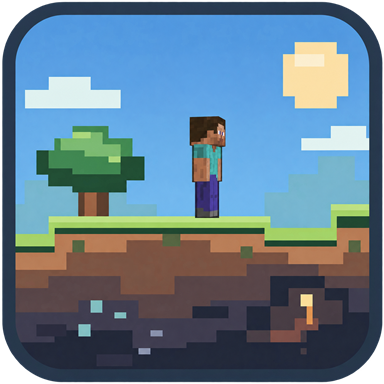
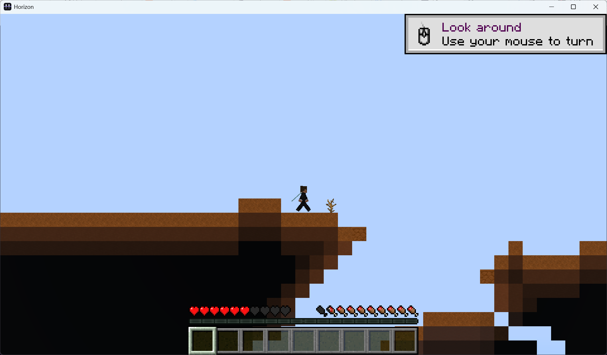
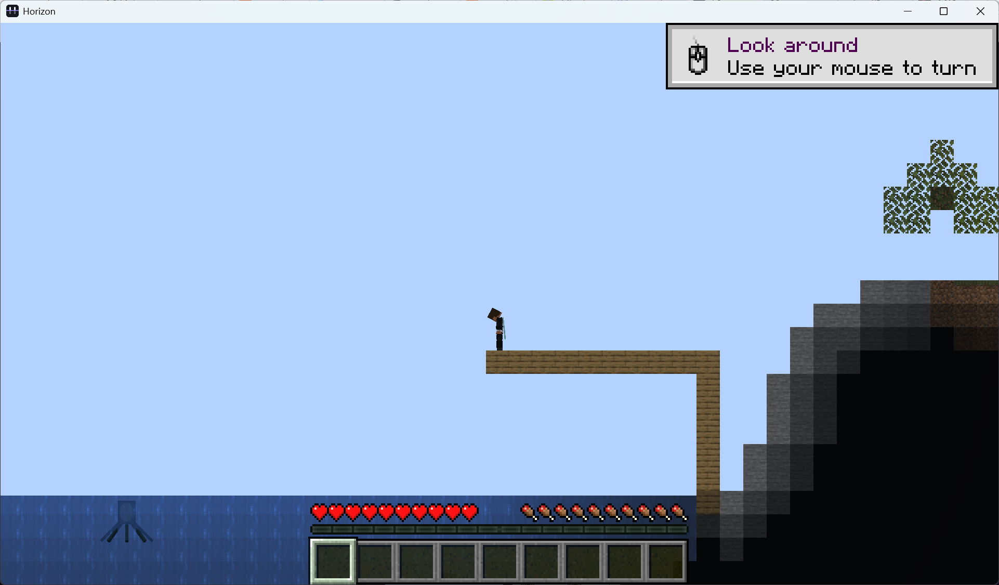

# Planar Worlds

English · [简体中文](README.zh.md)

**0.3.7 migration status.** The new `.hmod` package format and SDK entry point pass local checks. The existing game-internals mixins still require adaptation to Horizon's function-replacement SDK before this version can be built into a playable client.

Planar Worlds is a native Rust mod for Horizon that turns the Minecraft Overworld into a 2D side-scrolling world inspired by Terraria. Explore the surface, dig into caves, mine ores, and build.

## Features

- **Single-layer terrain.** The foreground at `Z=0` includes hills, caves, ores, bedrock, and fluids. The 0.3.7 generator places trees and three surface layers behind it at `Z=1`, with vertical trunks and symmetric canopies.
- **Fixed side view.** An orthographic camera follows the player in the X/Y plane. Players and mobs face left or right.
- **Lighting in the terrain cross-section.** Sky light and block light spread through the slice. Light fades into the rock one block at a time, hiding unlit ores.
- **Background walls.** Blocks at `Z=1` appear behind the foreground. You can place and mine them, and walk through them.

## Gameplay screenshots






## Controls

Enable **Planar Mode** on Horizon's Create World screen before creating a world.

| Input | Action |
| --- | --- |
| `A` / `D`, `Space` | Move left or right, and jump |
| Move the mouse | Aim at the first block hit within reach. A black-and-white outline marks the target. |
| Hold left-click | Keep mining the targeted block. |
| Right-click | Interact with the targeted block or use its face to place a block. |
| Hold right-click while aiming at an empty cell with a block in hand | Place directly in the empty cell within reach, up to five blocks away. Cells occupied by the player are excluded. |
| `Ctrl` + left-click / right-click | Mine or place background walls. A gray outline marks the background target. |

The tree generation fix applies to newly generated chunks. Existing worlds can still be played and explored.

## Limitations and compatibility

- **Dimensions and portals.** Planar Mode currently supports the single-player Overworld only. Nether portals, End portals, and 2D versions of the Nether and the End have yet to be implemented.
- **Limited compatibility with other mods.** Planar Worlds changes world generation, rendering, movement, collision, and block interaction. Mods that change the same systems may conflict.

## Installation

Version **0.3.7** targets **Horizon / Minecraft 26.3**. Its SDK is pinned to the published Nightly commit `0b14f8acfd97fa2c750e42795249dcc981178ca4`. Native game-internals compatibility remains pending.

### Build from source

Clone this repository and enter its directory. Select your instance in the Horizon Launcher and build the native mod. You can also specify the source directory and instance on the command line.

```sh
horizon-launcher native-build . --instance "Instance name" --trust-native-code
```

The launcher build currently requires further adaptation of the mixins. The source package uses the flat `.hmod` layout with `horizon-mod.toml`, `Cargo.toml`, and `src/`. The launcher generates its internal Mixin manifest during staging.

### Check the Rust code locally

Fetch the pinned SDK and check the mod entry point from the Planar Worlds repository.

```sh
cargo horizon-mod hooks camera
cargo check --locked
cargo horizon-mod build
cargo horizon-mod check target/horizon-mod/planar_worlds.hmod
```

These commands validate the SDK entry point and package. A successful package check does not validate the game functions named by the [native Mixin declarations](horizon-mod.toml). Several existing targets, including projection, collision and meshing functions, have no replacement slot in the pinned SDK.

## License

This repository uses the [MIT License](LICENSE). Horizon and Minecraft code and assets remain subject to their respective licenses.

## Development attribution

The code was generated by ChatGPT 6.1 Sol. Humans were responsible for the architecture and testing.
