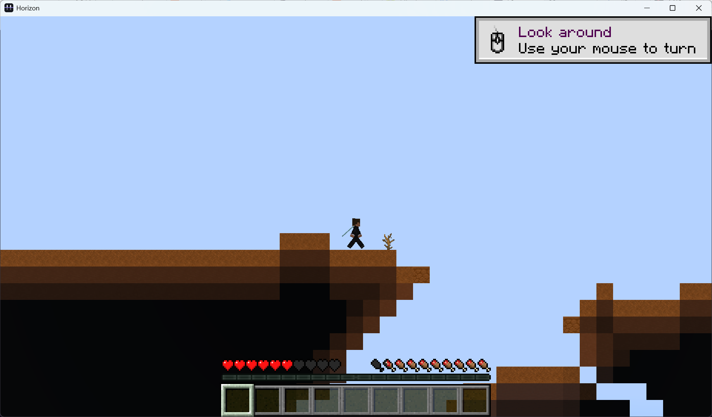
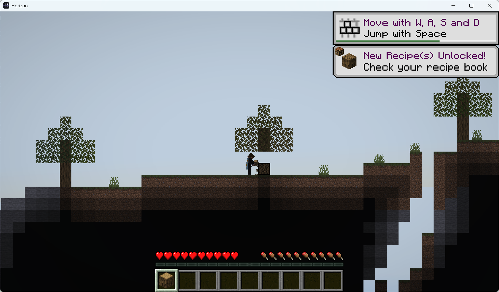
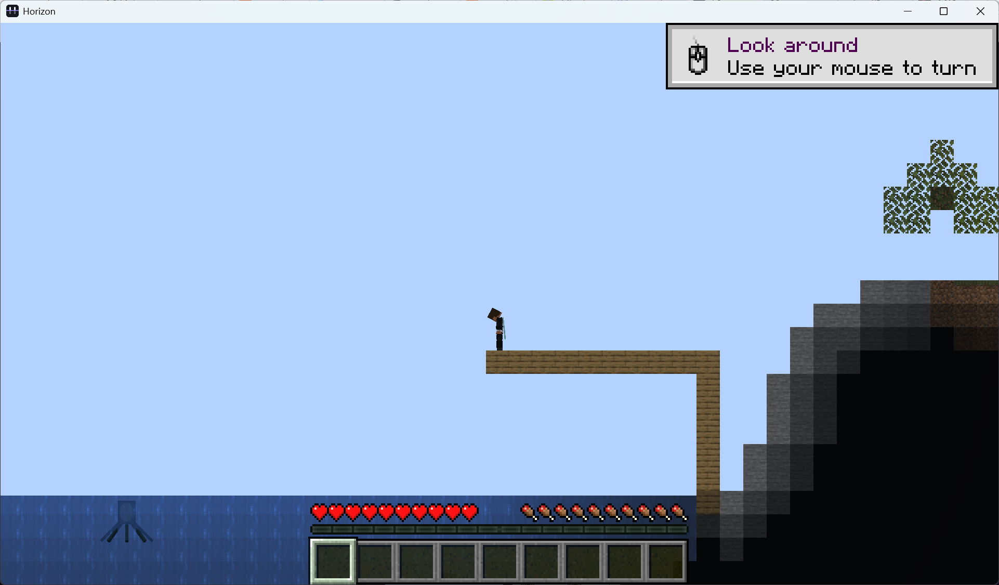

# Planar Worlds

**0.3.7 迁移状态**。新版 `.hmod` 包格式和 SDK 入口已通过本地检查。现有游戏内部 Mixin 仍需适配 Horizon 的函数替换 SDK，完成后才能构建可玩的客户端。

[English](README.md) · 简体中文

Planar Worlds 是 Horizon 的 Rust 原生模组。它把《Minecraft》的主世界变成类似《泰拉瑞亚》的 2D 横版世界。你可以沿地表左右探索，也可以从侧面挖进洞穴、采矿和建造。

## 玩法

- **单层地形**。前景位于 `Z=0`，保留地表高差、洞穴、矿石、基岩和流体。新生成的区块会生成平面的树干和树冠。
- **固定侧视**。正交镜头沿 X/Y 平面跟随玩家，角色和生物以左右侧身显示。
- **剖面光照**。天空光和方块光沿剖面传播，岩层亮度逐格衰减，完全无光的矿石被黑暗遮住。
- **背景墙**。背景位于 `Z=1`，渲染在前景后方，可放置和挖掘，也可以直接穿过。

## 实机截图







## 操作

在 Horizon 的创建世界界面打开 **Planar Mode**，然后创建世界。

| 操作 | 效果 |
| --- | --- |
| `A` / `D`、空格 | 左右移动、跳跃 |
| 移动鼠标 | 瞄准触及范围内最先命中的方块，黑白线框标出目标 |
| 按住左键 | 持续挖掘命中的方块 |
| 右键 | 对命中的方块执行原版交互或放置 |
| 手持方块，按住右键指向空气 | 在触及范围内直接放置，最多 5 格，避开玩家身体占用的格子 |
| `Ctrl` + 左键 / 右键 | 挖掘 / 放置背景墙，灰色线框标出背景目标 |

树木生成修复会在新生成的区块生效。旧世界可以继续游玩和探索新区块。

## 功能限制与模组兼容性

- **维度与传送门**。当前的 Planar Mode 仅支持单人主世界。下界传送门、末地传送门，以及下界和末地的 2D 维度均未实现。
- **与其他模组的兼容性较低**。Planar Worlds 会修改世界生成、渲染、移动与碰撞以及方块交互。其他模组如果也修改这些系统，可能发生冲突。

## 安装

当前迁移版本为 **0.3.7**，目标为 **Horizon / Minecraft 26.3**。SDK 固定到已发布的 Nightly 提交 `0b14f8acfd97fa2c750e42795249dcc981178ca4`。游戏内部 Mixin 的兼容性适配仍在进行。

### 从源码构建

克隆本仓库并进入源码目录，在 Horizon 启动器选择要使用的实例并构建原生模组。也可以通过启动器的命令行显式指定源码目录和实例：

```sh
horizon-launcher native-build . --instance "实例名称" --trust-native-code
```

启动器原生构建仍需进一步适配 Mixin。源码包采用扁平的 `.hmod` 结构，包含 `horizon-mod.toml`、`Cargo.toml` 和 `src/`。启动器会在暂存阶段生成内部的 Mixin 清单。

### 本地 Rust 检查

在本仓库获取固定版本的 SDK 并检查模组入口。

```sh
cargo horizon-mod hooks camera
cargo check --locked
cargo horizon-mod build
cargo horizon-mod check target/horizon-mod/planar_worlds.hmod
```

这些命令检查 SDK 入口和包格式。包校验成功不能验证 [原生 Mixin 声明](horizon-mod.toml) 中的目标函数。现有投影、碰撞和网格等部分注入目标在固定版本 SDK 中没有可替换槽位。

0.3.7 的树木生成逻辑已将树干、树叶和地表三层土壤写入背景层 `Z=1`，前景 `Z=0` 用于玩家行走与挖掘。该改动需要上述原生适配完成后才能在新版启动器中使用。

## 许可证

本仓库使用 [MIT 许可证](LICENSE)。Horizon 和 Minecraft 的代码与资源各自遵循其原有许可。

## 开发声明

本项目的代码由 ChatGPT 6.1 Sol 生成，架构设计和测试由人类负责。
